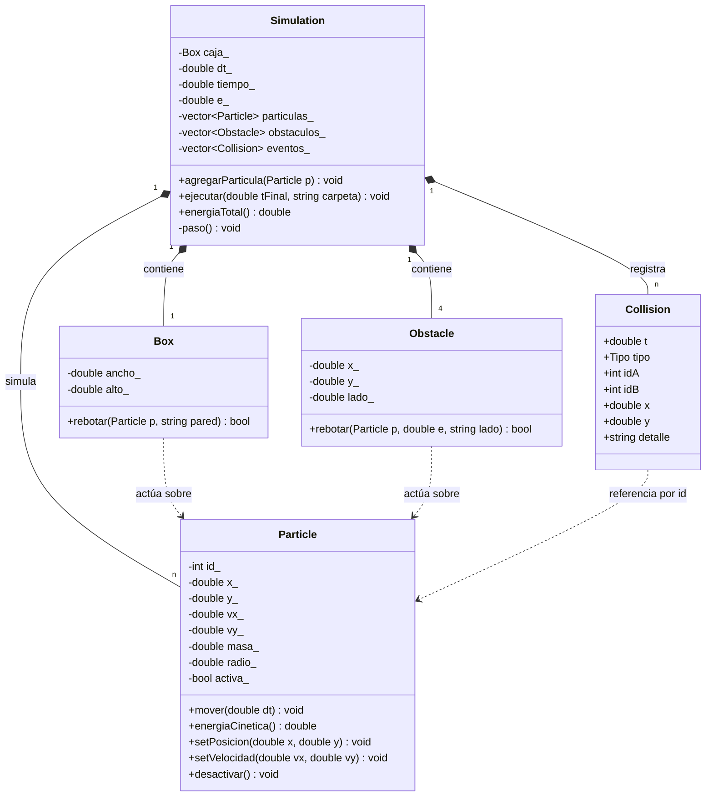

# Diagrama de clases · Parte 1

Se agregan clases a medida que se implementan. Estado actual: `Particle` implementada; el resto es el diseño previsto.

## Relaciones

- **Composición (`*--`):** `Simulation` es dueña de la caja, las partículas, los obstáculos y el registro de colisiones.
- **Dependencia (`..>`):** `Box` y `Obstacle` no guardan partículas; reciben una, la corrigen y devuelven si hubo choque.# Diagrama de clases

Pendiente de diseñar. Se actualiza a medida que avance la Parte 1.
